= 架构与模块实现
:toc:

== 总体结构

三个Vue应用通过同站点代理访问同一个Spring Boot后端。MySQL保存身份、授权与审计事实，Redis保存会话及登录限流信息。Navicat和Apifox是开发工具，不是运行时依赖。

[source,text]
----
浏览器：admin / oa / pmis
    ↓ Cookie + CSRF，同站点 /api/v1
Spring Security → 方法权限 → 功能服务 → MyBatis → MySQL
       ↕ Redis Session/限流       ↳ 同事务审计
----

权限每次读取MySQL当前事实。当前没有权限快照缓存、JWT、微服务、消息驱动撤权或跨域SSO；既有用户权限也不依赖授予者当前是否仍有权限。

== 技术栈与工程入口

[cols="2,3,4",options="header"]
|===
|部分 |当前项目基线 |入口/约束
|后端 |Java21、Spring Boot3.5.16、MyBatis starter3.0.5 |backend/pom.xml；单一Maven构建，Maven wrapper3.9.11
|存储 |MySQL8.4、Redis7.4.6、Flyway |compose.yaml测试/新环境MySQL8.4.7；当前宿主8.4.8
|前端 |Vue3.5.22、Router4.6.3、Pinia3.0.3、TypeScript5.9.3、Vite7.1.12 |frontend工作区；pnpm12.4.2，精确锁文件
|验证 |JUnit、Testcontainers、ArchUnit、JaCoCo、Puppeteer |真实MySQL/Redis集成与真实浏览器测试
|说明 |AsciiDoc、Mermaid、OpenAPI3.0.3 |pnpm -C frontend run docs
|===

这是当前项目锁定版本，不表示这些版本已通过生产支持/安全评审。后续升级单独验证，不在说明整理时悄悄改版本。

== 后端模块

统一包根为backend/src/main/java/com/municipal/rbac/。

[cols="2,4,5",options="header"]
|===
|包 |实现与关键文件 |依赖和边界
|identity |IdentityDirectory、IdentityData、内部IdentityMapper；组织、人员、账号、闭包、版本规则 |不依赖authorization或Spring Security；PasswordHasher是算法端口
|authorization |PermissionChecker/Resolver、AccessManager、ScopePolicy、内部GrantMapper/AccessMapper |统一权限计算、范围并交集、角色/委派/责任；核心不依赖HTTP、安全适配或OA/PMIS
|security |SecurityConfig、PermissionBridge、SessionValidityFilter、SessionPolicy、LoginThrottle |认证、CSRF、会话、默认拒绝与方法授权适配；实现密码散列适配
|administration |IdentityController、AccessController、IdentityAdministration、EmployeeAssignment |管理用例组合层；从认证主体取得Actor，协调身份、授权和审计事务
|audit |AuditLog |追加脱敏变更事件、平台分页读取；不记录密码、电话、姓名或会话标识
|bootstrap |RbacApplication、AdminInitializer、DemoAccountsInitializer、HealthController |启动组合根、显式引导/演示初始化；不在重启时恢复撤销的角色
|oa / pmis |OaController / PmisController |只有真实鉴权演示，不存在公文/项目CRUD或审批表
|imports |package-info |职责预留，尚无在线解析/提交引擎
|shared |ApiResponse、ApiError、DomainFailure、PageResult |共用响应与错误，避免成为万能业务工具包
|===

业务模块通过authorization公开接口请求授权，不跨包读取其内部Mapper。控制器负责HTTP适配，服务负责规则和事务；统一构造器注入。

== 前端模块

[cols="3,6",options="header"]
|===
|位置 |职责
|frontend/apps/admin/src |AdminWorkspace组合五工作区；OrganizationWorkspace、RoleWorkspace、ApplicationWorkspace、AuditWorkspace、Workbench读取真实API
|admin/src/components |GrantEditor完整角色集合，AssignmentEditor原子调岗，ScopeEditor/PeopleScopeEditor区分数据/人员范围，选择器真实分页，EditorDialog/PreviewSummary统一表单
|admin/src/context.ts |当前应用、管理能力、受限组织目录、错误及未保存提示；最终权限仍由服务器核验
|frontend/packages/api |client统一Cookie/CSRF/错误；administration为薄适配；schema.generated.ts从OpenAPI生成
|frontend/packages/shell |共用登录、会话、导航和挂载；OA/PMIS保留明确标注的原型
|frontend/apps/oa、pmis |独立业务前端位置；完整业务页面待开发，不继续堆入共享shell
|===

== 三条核心调用链

=== 登录与访问

. GET csrf取得当前会话令牌；POST login携带令牌及表单账号密码。
. 登录后服务端轮换会话；前端GET me取得当前主体，不持久化权限或密码。
. 每次受保护请求校验会话绝对/空闲时间、账号启用和auth_version；方法授权调用统一PermissionChecker。
. 未声明API默认拒绝；数据库或必要Redis不可用时503，不因设施故障放行。

=== 授权变更

. 查询最新角色/人员授权版本，编辑权限、范围、有效期或完整角色集合。
. 服务端预览绑定操作者、目标、类型、组织版本和授权命名空间版本，15分钟有效。
. 确认时重核当前资格、责任与新增权限上限；变更、版本增加、消费预览、审计同一MySQL事务。
. 409保留编辑内容并重新回读；不自动覆盖或重放写入。网络失败不能推断事务一定未提交。

=== 人员变动

EmployeeAssignment协调IdentityDirectory和AccessManager，一次性校验组织/岗位、本人各应用新角色、管理任职与责任。成功才整体提交，失败保留原状态；不修改其他员工的成员关系。

== 并发、实时性与可扩展点

一般授权写先锁组织目录，再按应用顺序锁授权命名空间，最后按稳定ID锁主体；人员跨应用变动采用更强的目录/多应用锁。最后平台管理员另受保护。具体字段见07，接口版本见06。

范围计算保留SELF、组织和子树模板，不能用“当前没有子节点”证明未来子树已授权。请求固定同一个Clock时刻检查[from,to)。权限生效以目标自己的关系为依据，维护责任CURRENT/AWAITING只影响后续维护。

后续扩展优先保持这些公开接口和事务边界。资源、导入、业务状态机、角色继承和约束各自按切片增加，不修改已应用V1–V3。
