= 系统设计与结构化详细设计
:toc:
:sectnums:

== 数据库设计

可执行 DDL 唯一来源 backend/src/main/resources/db/migration/；字段字典和 ER 由 scripts/schema_docs.py 生成。
当前 8 表只支撑身份、组织资料及 RBAC0。OA 公文、PMIS 项目、审计、导入任务和授权事件的表留待对应功能的新增迁移；不要把设计稿误认为已落库。

include::database.generated.adoc[leveloffset=+2]

=== 约束与生命周期

所有表使用 InnoDB、utf8mb4_0900_as_cs；业务编码按规范小写且保留，不复用停用编码。
BIGINT 通过生成类型/响应显式转十进制字符串，普通计数仍为数字；phone/username 为字符串。
连接 session time_zone 设为 +00:00，DATETIME(3) 存 UTC；API 使用 ISO8601 Z 时间。
组织父节点/员工主要组织/账号员工/权限应用及授权关系均使用 FK RESTRICT；不级联删除。组织环和层级合法性在未来组织事务中检查。
账号/组织/角色/权限优先停用保留编码；关系物理移除并由未来审计追溯，不给关系机械加 deleted 字段。
同一 user-role 或 role-permission 只有一条当前关系，原位修改有效期；多个角色是独立授权来源，不覆盖彼此。
后续更新用户角色：锁定目标 id_user 行，比较 grant_version，集合替换与版本+1、审计和事件在同一事务；角色权限锁 auth_role 行比较 version。不同作用域不共用全局锁；冲突409。
初始化只插入目录和引导角色；账号由环境配置产生，BCrypt，未配置不建立默认口令。重复启动不重设已有密码；引导结束清除环境密码。

=== 关键查询和索引

. 登录按 uk_user_username 等值检索，显式字段。
. 权限按 auth_user_role 主键前缀 user_id→auth_role→auth_role_permission 主键 role_id→permission/app；一次 JOIN 读取启用来源，在Resolver用Clock判断两种时间区间并以集合去重。每次请求一次来源查询，不逐权限点访问 Redis。
. 未来人员列表 WHERE organization_id=? AND enabled=? AND id>? LIMIT ? 使用 ix_employee_org；复杂组织子树先确定授权组织集合，禁止查完后前端隐藏。
. 未来本人业务列表 owner_user_id + created_at + id 复合索引；OA/PMIS 各自建表。
. 用 EXPLAIN ANALYZE 和合成万人员/多角色数据检验 rows/loops、排序、回表；本轮不把索引推测当已执行计划验证。

== 界面原型

实际采用 frontend-design 技能：市政企业的行政工作台，蓝灰导航、青绿选中组织、明确文字状态。字体 Microsoft YaHei UI/PingFang SC，标题24、正文14–16、说明13；不依赖外部字体/CDN。布局左对齐，组织树与员工列表是主体。
tokens：深蓝 #17324d、青绿 #087f8c、画布 #f2f5f8、文本 #243746、边框 #d8e1e8、警示 #946200。
审视修订：通用卡片首页不能帮助组织管理，改成树-表双栏；角色采用列表-权限-成员的工作区，有效期编辑显示半开区间；原型状态切换与真实链路分离。

[source,text]
----
应用导航 | 页面标题                     当前用户/退出
         | 当前链路状态与操作反馈
         | 组织树(角色列表) | 员工表(权限+成员)
         |                | 校验预览/有效期
----

独立可编辑原型源在 docs/prototypes/index.html，实际Vue骨架源在 frontend/packages/shell/。独立HTML仅用于离线评审流程，不是第二份客户端或业务实现；后续业务功能以Vue为准。组织、角色/成员、授权期、导入预览及业务页均有入口。
演示数据统一标识“合成原型数据”；保存/导入执行按钮禁用；401/403/失败/空数据/加载/同步中可切换。真实演示接口由“验证访问”调用，不与原型数据混淆。

== API设计

contracts/openapi.yaml 是唯一基线，生成 TypeScript 模型；成功为 {data}、错误为 {code,message,traceId,details?}。
本轮只暴露 health、csrf、login、logout、me 和三个 demo；未来接口仅以 x-planned-operations 描述，不把未实现路径暴露成成功。
page从1、size默认20最大100；非法值400，空结果正常200；排序仅可用契约白名单。未来覆盖更新使用 expectedVersion，409可识别。
Apifox私有项目与MCP已就绪，当前8接口已导入并完成语义回读；实时状态与证据统一见plan和verification，不把未来管理接口的设计稿写成已同步契约。

== 结构化模型

用户→三前端→统一API→认证/权限服务→MySQL；认证上下文↔Redis Session。导入原始表只读分析，本轮不进入在线库。
功能分解：身份识别→认证→会话约束→统一操作授权→业务演示；管理规划→组织人员→角色授权→导入预览；审计/同步属于后续功能。

[cols="1,3,3,4",options="header"]
|===
|模块 |输入 |输出 |处理/异常与依赖
|identity |规范用户名/主体ID |账号状态/密码散列/版本 |MyBatis只查身份表；不依赖权限或业务。
|authorization |主体ID、会话ID、应用/动作、可选资源上下文 |权限集合/允许与否 |PermissionChecker/Resolver；内部MyBatis读RBAC；核心无HTTP类型。
|security |认证上下文、Cookie、CSRF |401/403/503或通过 |Spring Security认证/方法授权适配；绝对时长和账号版本；不另加AOP或MVC权限检查。
|bootstrap |环境管理员账号密码 |首次账号及角色关系 |组合根专用事务/Mapper仅供引导初始化账号和用户角色；业务模块不共享；已有账号不重置/提权，无密码不默默建号。
|oa/pmis |已认证授权的演示请求 |明确无业务记录的演示结果 |不读authorization Mapper或表，不自行判角色名。
|audit/imports |后续操作/上传 |后续审计/预览 |本轮仅职责文档，不建无语义Controller/空服务。
|===

image::diagrams/modules.svg[模块依赖,width=1000]

== 安全处理流程

. csrf GET公开并生成token；登录POST采用表单 username/password，经CSRF后由Spring Security认证；会话固定攻击防护 changeSessionId；设置服务端 authenticatedAt。
. 登录成功返回{data:{authenticated:true}}，前端重新获取CSRF并me。权限不放Session；principal包含主体ID和账号身份版本，认证凭据擦除。
. 每个受保护请求校验空闲/绝对时长及DB账号启用/身份版本；缺失authenticatedAt按无效身份处理。绝对时长使用Clock，达到上界即失效并401。
. 请求层只根据明确的公开/登录注解或PreAuthorize声明开放；无声明的处理方法默认拒绝。真正权限计算仅由方法授权调用统一检查器；覆盖测试确保注解未遗漏。
. PermissionResolver使用传入Clock时刻，检查账号/角色/权限/应用的enabled及两种关系的[from,to)，合并多来源。PermissionChecker还要求应用前缀一致；资源归属规则未来在业务服务/SQL实现，不塞进Resolver。
. 退出采用Spring Security logout，撤销当前服务端会话并清Cookie。改密/停用未来事务增加auth_version；当前每次请求与DB比较，旧会话即失效（无需等浏览器清Cookie），未提供管理写接口。
. 安全链EntryPoint/DeniedHandler返回JSON；最外层设施异常适配捕获Session读取/提交中的Redis故障，ControllerAdvice处理业务数据访问异常；均不输出异常堆栈。

Cookie SESSION：HttpOnly、SameSite=Lax，本地HTTP secure=false；prod必须HTTPS并secure=true。CSRF存服务端Session，token只由公开接口返回，前端内存持有，不写localStorage；fetch credentials同站点。
健康是存活探针，不依赖数据库/Redis；未知API默认拒绝；没有CORS放开或跨域SSO声明。

== 后续实时授权与导入设计（未实现）

MySQL为事实源。用户授权版本(user)、角色权限版本(role)、应用配置版本(app)分域，事件与关系/审计同事务提交；Redis CAS只接受更大版本，事件键+版本幂等。
接口返回SAVED/PENDING/APPLIED，提交后同步不能冒充数据库Redis原子事务。pending撤销建议对影响主体请求返回503直到可靠状态可确认；已开始执行请求不承诺追溯撤回，敏感写事务提交前再核版本。
后台扫描持久事件+重试/退避，对账启动/重连/漏消息；发布订阅只加速。此段是以后引入缓存时的条件性设计，原1秒同步建议不是本阶段授权验收口径；已确认v2采用数据库提交后新请求读取当前事实。
缓存按用户/应用索引并携带依赖角色版本；请求一次批量读版本。加载前后核对，变化则丢弃重试；单飞合并回源，跨实例短锁/限流保护DB，不用JVM锁宣称分布式保证。
快照包含原始有效期或nextChangeAt（未来开始和结束）；跨边界重新判断多个来源。版本不可可靠读、pending不可确认、必要快照不可得均503。第一轮直接查库，因此无过期快照放行窗口。
导入：上传→解析→字段/组织映射→全部校验预览→确认→事务提交→结果；失败整批回滚。摘要+映射版本+文件哈希为幂等键，确认时再核组织/账号版本；同名负责人要求唯一账号/人工映射。详情见source-audit。

== 权限平台菜单与应用委派方案（方向已确认，管理写功能未实现）

已确认：业务管理员可以登录权限平台，对平台委派的业务应用执行授权；平台同时指定其可管理的人员组织范围，可显式选择全公司。用户已接受5工作区和前述功能方向；剩余目录/生命周期细则见requirements确认清单。当前Vue已落实导航、详情标签和交互原型，管理写功能仍未实现。

用户认可功能方向，并要求整合菜单、优先功能完整与整洁。建议由9个功能入口收敛为5个一级工作区，按实际任务组织，具体管理动作进入详情页、标签页或抽屉。原来的组织管理、用户管理、角色权限管理等保留为功能职责，不再全部占用侧栏。

[cols="2,5,4",options="header"]
|===
|一级入口 |工作区内容 |整合的原功能
|工作台 |到期提醒、最近授权、当前管理范围及常用任务入口 |工作台；避免堆放无操作意义的统计卡片
|组织与用户 |左侧组织树，右侧人员与账号列表；选用户进入详情/应用授权；组织编辑和导入作为上下文操作 |用户管理、组织管理、人员导入
|角色与授权 |角色列表及详情；详情采用基本信息、权限配置、角色成员3个标签页 |角色管理、角色权限管理、角色成员分配、授权有效期
|应用与资源 |应用列表及详情；详情采用基本信息、资源权限、管理员与范围3个标签页 |应用管理、资源目录、权限点管理、应用管理员委派
|操作审计 |按应用、操作者、目标用户、操作类型和时间筛选，查看变更前后差异 |授权审计及相关管理变更记录
|===

推荐交互：顶部持续展示当前管理应用和可管理组织范围；应用选择器只列操作者可管理的应用。应用上下文不改变人员的实际组织归属，全局身份/组织设置仍需独立管理权限。侧栏保持扁平，页面标题、选中对象和面包屑帮助定位，不增加多层折叠菜单。

组织与用户采用“组织树＋人员表”；不单独设置部门管理一级入口，组织节点旁提供组织设置操作。列表区提供账号状态、组织、当前应用角色等必要列，人员与账号仍保持独立模型。用户详情提供基本资料、应用授权和授权记录，授权编辑用右侧抽屉；选角色及有效期后预览并确认，复杂的用户历史保留详情页。

角色与授权的“权限配置”就是原角色权限管理的唯一编辑界面，使用资源树和动作勾选矩阵。角色成员支持从角色出发批量添加人员；与用户详情的分配角色共享同一授权组件、校验和提交逻辑，只改变操作视角。成员授权和角色权限各自的有效期在对应编辑流程中设置，不再设独立的“授权有效期”侧栏。用户的有效权限及来源只读展示。

应用与资源的“资源权限”采用左侧功能资源树、右侧权限点列表/编辑区，资源目录和动作定义就近维护。新增权限点须与真实后端检查对应，由平台或开发维护；目录层次不隐式授予后代。平台在“管理员与范围”配置应用管理员及组织范围，业务管理员默认只读自己被委派的设置。

平台管理员通常可见5个一级入口；业务管理员以工作台、组织与用户、角色与授权、操作审计为主要入口，应用目录维护入口按权限提供。只读查看资源可直接进入角色权限配置中的资源树，不必增加一个日常菜单。平台负责全局账号/组织编辑和权限目录维护，业务管理员只在委派范围内维护本应用普通角色和授权。菜单整合不合并服务端权限点：查用户、改组织、分配角色、改角色权限、维护权限点、查看审计仍分别检查。

Q001已确认采用“维护角色并分配”：业务管理员可创建/修改本应用普通角色及角色权限，并在被委派人员范围内授予、撤销角色，可委派权限上限由平台控制。平台保留账号/组织维护、权限目录维护、应用管理员任命及委派范围设置。此决定尚未落地管理写接口。

Q002已确认：应用通用角色由平台维护，业务管理员只能向自己范围内人员授予获准分配的通用角色；其可创建组织专用角色，角色人员适用范围不得超出管理员范围。角色定义/权限修改及停用要求操作者覆盖角色完整适用范围，并符合可委派权限上限；专用角色授予要求目标人员同时满足管理员范围与角色适用范围。该范围约束针对可授予人员，不决定OA/PMIS业务记录的数据可见范围，也不是RBAC角色继承。未来接口须分别测试人员越界、角色范围覆盖不足及共享通用角色不可编辑。

Q003与Q004共同确定：通用角色清单与权限点上限由平台指定，新增/扩大授权还须为操作者当时本人实际拥有；该次可授予上限为两者交集。用户明确要求既有授权独立生效，不能再用授予者或当前责任管理员的权限/委派状态裁剪用户权限。管理资格与业务权限仍分别检查，不能以“本人拥有”代替委派资格；授予人只作来源审计。

用户已确认link:development-baseline.adoc[RBAC0后续开发基线v2]，其余方案沿用上一版。维护责任与授权生效分离，管理员交接不改他人角色，人员变动由平台单事务替换本人旧/新角色及必要管理委派；失败回滚、责任待接管及新增权限差异校验均已定稿。D08继续直接查库，缓存为条件性演进，未实现完整管理写功能。

视觉沿用当前市政工作台的蓝灰导航、青绿操作强调与统一中文字体，内容左对齐。以稳定侧栏、清晰表格、单一主操作和适量留白形成秩序；状态使用文字加颜色，受限动作说明原因。标签页用于同一对象的不同方面，不在页面横向塞入全部功能，也不把抽屉嵌套成多层弹窗。应用切换/关闭编辑时若有未保存修改应明确处理，避免授权改到错误上下文。

组织树建议左侧展示，总公司/分公司/部门使用类型标记；右侧为组织信息与成员。人员资料、账号、组织归属仍分开建模；人员没有账号时不能凭员工编号直接授予登录权限，需先走明确的建号流程。

业务角色建议归属单个应用，例如OA公文管理员、OA审批员、PMIS项目经理。一个账号可在不同应用拥有不同角色；平台管理角色单独管理。授权链为账号→角色→权限，不新增用户直配权限的旁路；界面“查看有效权限”展示角色来源而不是另存一份用户权限。目录层次不是RBAC1角色继承。

管理资格、管理应用、可管理人员与可委派权限必须分别检查。拥有某项业务操作权限不自动意味着可以把该权限授予别人。业务管理员默认不能任命新应用管理员、改变自己的管理范围或操作受保护的平台角色，避免通过编辑角色给自己提权。后端从认证主体取操作者，对请求中的应用、目标用户组织、角色归属、可委派权限集合及有效期交叉核验；不能相信前端应用选择器。

人员范围按应用单独委派，保留显式全公司及仅本节点/含下级选择，不从管理员本人所属组织推断。管理人员范围与业务记录数据范围分开计算。人员调岗采用明确的撤旧/授新流程，只改本人角色；范围不足的原管理员失去继续维护资格，由平台处理交接。管理员本人调岗/失权不影响已授他人权限，用户业务读取不依赖维护责任是否已接管。

例：平台将OA交给管理员A管理，人员范围选工程分公司且含下级。A可以在平台为范围内已建号人员授予OA审批员并设置有效期；对同一人员授予PMIS项目经理、对范围外人员授权或任命OA新管理员均应被拒绝，除非平台另行明确委派相应管理能力。

模型影响：现有V1角色为全局角色、引导角色跨三个应用，仅用于当前骨架。正式单应用业务角色、管理员应用/组织委派及可委派集合需要新增迁移和对应API/审计设计；应用授权与组织范围不是当前页面换名即可具备。已应用V1不改写，本次不新增管理API或数据库表。后续验收须覆盖篡改appId、角色跨应用、目标人员越界、管理员自我提权、组织子树边界、并发覆盖及撤销后的再次操作。

演示账号隔离：DemoAccountsInitializer仅在demo配置下运行，从唯一JSON目录读取账号/口令，BCrypt保存；与prod组合直接拒绝。首次创建才写演示角色/成员，重启不恢复被撤销的权限或重置口令。当前业务管理员演示账号只具备平台演示入口及对应OA/PMIS演示访问，不具备尚未实现的组织范围委派写能力；不能据此宣称管理员授权功能已完成。旧随机引导账号仅在本机显式指定时停用并增加身份版本，保留历史，不删除员工或账号资料。

== RBAC演进影响

[cols="1,4,3,3",options="header"]
|===
|阶段 |新增/改变 |保持 |回归
|RBAC1 |独立role_hierarchy多父边、事务环检测，Resolver闭包 |Checker接口、业务权限声明 |菱形去重、环、禁用/到期、多来源
|RBAC2 |分配约束服务、SSD/基数持久规则，锁定目标集合 |认证链、权限码 |并发超额/互斥、事务回滚
|RBAC3 |组合继承/约束；DSD会话激活角色存储与约束 |HTTP契约基础、业务数据范围分离 |继承下互斥、激活/撤权、跨会话
|===
